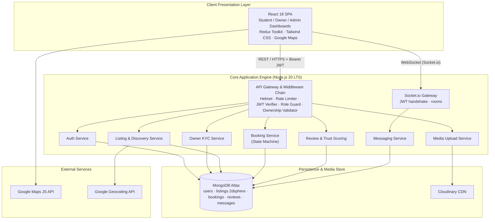
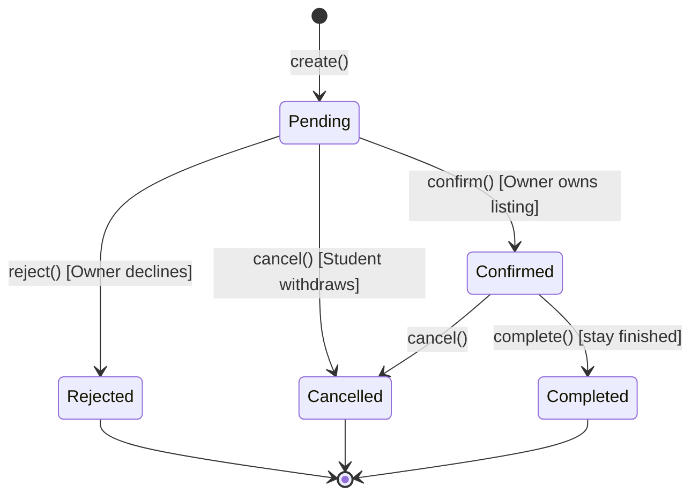
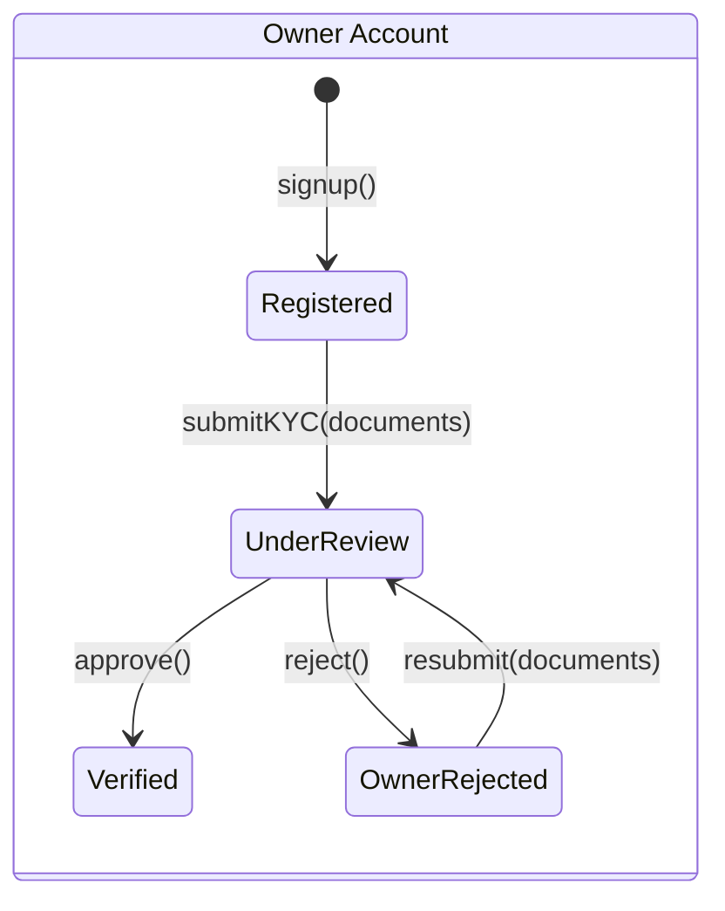
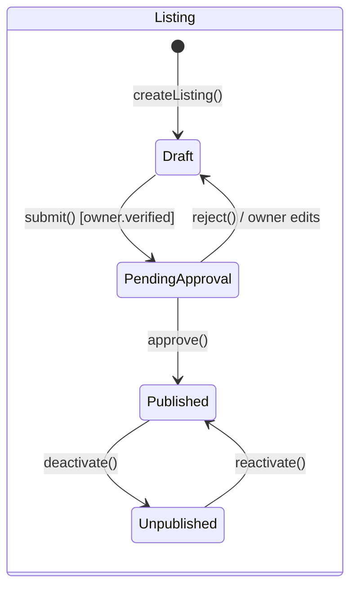
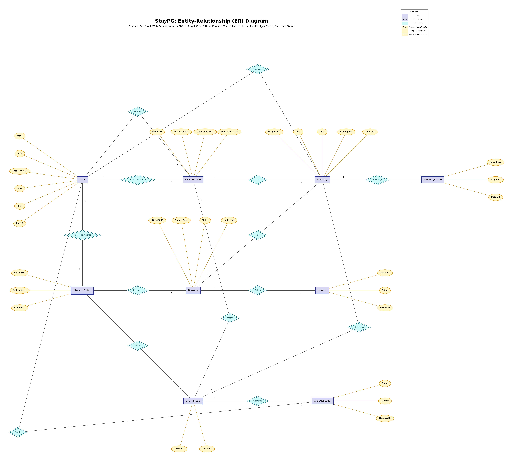

<div align="center">

# 🏠 (Thapar-PG-Finder)

### Verified PG & Hostel Discovery and Booking Platform for Students in Patiala

*A role-based MERN marketplace with geo-indexed search, real-time negotiation and booking-gated trust scoring.*


**Thapar Institute of Engineering and Technology, Patiala** · Department of Computer Science & Engineering · Academic Year 2026–2027

</div>

---

## 📑 Table of Contents

1. [About the Project](#-about-the-project)
2. [The Problem We Solve](#-the-problem-we-solve)
3. [Key Features](#-key-features)
4. [Project Objectives (SMART)](#-project-objectives-smart)
5. [System Architecture](#-system-architecture)
6. [Technology Stack](#-technology-stack)
7. [Core Design Mechanisms](#-core-design-mechanisms)
8. [Database Design (ER Model)](#-database-design-er-model)
9. [Project Documentation & PDF Links](#-project-documentation--pdf-links)
10. [Performance Results](#-performance-results)
11. [Getting Started](#-getting-started)
12. [Testing & Validation](#-multi-tier-testing--validation-framework)
13. [Project Schedule](#-project-schedule)
14. [Future Work](#-future-work)
15. [Repository Structure](#-repository-structure)
16. [Authors & Team](#-authors--team-information)

---

## 📖 About the Project

**StayPG** is a full-stack web platform that connects PG (Paying Guest) and hostel owners in **Patiala, Punjab** with students looking for accommodation. Every academic session, several thousand outstation students must secure housing within their first few weeks in the city. This market is almost entirely informal, run through word-of-mouth, commission-driven brokers and unmoderated WhatsApp/Facebook groups.

StayPG replaces that with an **Airbnb-style, verification-first marketplace** built on three principles:

| Principle | How StayPG enforces it |
|---|---|
| **Verified supply** | Every publishable listing comes from an owner whose KYC documents were approved by an Admin. No listing is public without explicit approval. |
| **Proximity-ranked discovery** | Search results are ranked by distance from a chosen campus using a MongoDB `2dsphere` index, with proximity resolved inside the database. |
| **Transaction-gated trust** | A review can only be submitted against a booking in the `Completed` state. An ineligible review is never created, so no after-the-fact moderation is needed. |

---

## ❗ The Problem We Solve

- **Information asymmetry.** Students cannot confirm that photos are current, that rent has no hidden charges, that the owner controls the premises, or that reviews come from real former tenants.
- **No student-specific attributes.** General real-estate portals do not model sharing type, gender preference, mess arrangement or walking distance from a specific campus gate.
- **Fraud-prone channels.** Classified sites and social-media groups impose no identity checks, which makes advance-payment fraud and bait listings routine.
- **No owner channel.** Genuine owners have no reputation-bearing digital presence and depend on brokers who capture a large share of the transaction value.
- **Manipulable ratings.** No available platform ties the right to review a property to a transaction that actually happened.

---

## ✨ Key Features

### 👩‍🎓 Student
- Register and log in with role-based dashboard
- Search by **campus, rent band, sharing type, gender preference and amenities**
- Results ranked by campus distance, shown as a listing grid and **Google Maps pins**
- Real-time **chat with owners** before booking
- Raise **booking requests** and track status (Pending → Confirmed → Completed)
- Submit **1–5 star reviews** only after a completed stay

### 🏢 Owner
- Submit **KYC / ID documents** for admin verification and earn a **Verified Owner** badge
- Create listings with details, **multi-image upload** (Multer + Cloudinary) and automatic **address geocoding**
- Manage incoming booking requests (confirm / reject), availability and room counts
- Chat with interested students

### 🛡️ Admin
- Review the **KYC queue** and approve or reject owners
- Approve or reject listings before they go live
- Platform oversight (abuse reports, verification queue)

### 🔐 Platform-wide
- **JWT access + refresh** authentication, `bcrypt` (cost 12) password hashing
- Refresh token in **HTTP-only, SameSite=Strict** cookie
- Ordered middleware chain: **token verification → role guard → resource-ownership validator**
- Helmet and `express-rate-limit` hardening
- Socket.io **JWT handshake authentication** and **per-conversation room isolation**

---

## 🎯 Project Objectives (SMART)

1. **Secure Role-Based Access Control.** JWT access/refresh auth with bcrypt across three isolated roles (Student, Owner, Admin), with **100% rejection** of unauthorised cross-role endpoint access in negative-path testing.
2. **Verified Listing Pipeline.** Owner onboarding and document verification where no listing is public without admin approval, with median publication latency **≤ 2.0 s** after approval.
3. **Geo-Indexed Discovery Engine.** Multi-criteria search over a MongoDB `2dsphere` index, ranked by campus proximity, within **≤ 500 ms** per query.
4. **Transaction-Gated Trust System.** A booking state machine plus a review eligibility gate that permits ratings only against `Completed` bookings.
5. **Real-Time Negotiation Channel.** Persistent one-to-one Socket.io messaging with delivery latency **≤ 300 ms** and full history durability across sessions.

---

## 🏗️ System Architecture

StayPG uses a modular, service-oriented, **three-tier architecture**: the *Client Presentation Layer*, the *Core Application Engine*, and the *Persistence & Media Store*.



> 📄 Detailed views: [Component Diagram](docs/uml/05_Component_Diagram.pdf) · [Deployment Diagram](docs/uml/06_Deployment_Diagram.pdf)

---

## 🧰 Technology Stack

| Layer | Technology | Purpose |
|---|---|---|
| **Frontend** | React 18, React Router, Redux Toolkit, Tailwind CSS, Lucide icons, Recharts | SPA, state management, responsive UI, dashboard charts |
| **Backend** | Node.js 20 LTS, Express.js (controller–service–repository layering) | REST API, business logic, middleware |
| **Database** | MongoDB Atlas + Mongoose ODM | Collections for users, listings, bookings, reviews, messages; compound and `2dsphere` indexes |
| **Auth & Security** | JWT (access + refresh), bcrypt.js, HTTP-only cookies, Helmet, express-rate-limit | Identity, password hashing, request hardening |
| **Media** | Multer + Cloudinary | Multipart upload handling, transformation, CDN delivery |
| **Real-time** | Socket.io | Chat with JWT handshake and room isolation |
| **Geolocation** | Google Maps JavaScript API + Geocoding API | Pin placement, address → GeoJSON, campus distance |
| **Testing & Tooling** | Jest, React Testing Library, Supertest, Postman, Git/GitHub | Unit, integration, API and security testing |
| **Deployment (target)** | Docker, GitHub Actions CI, Render/Vercel, MongoDB Atlas | Containerised cloud deployment |

---

## ⚙️ Core Design Mechanisms

### 1. Authentication, Role Guarding & Owner Verification
Identity is established once at login and **authority is re-evaluated on every request**. Credentials are checked against a bcrypt hash (cost 12); raw passwords are never stored. A short-lived access token is issued with a refresh token in an HTTP-only, SameSite-strict cookie. Protected routes pass through an ordered chain: *token verification → role evaluation → resource-ownership evaluation*, so a structurally valid token that belongs to the wrong actor is still rejected.

### 2. Geo-Indexed Discovery
At listing time the owner's address is geocoded to **GeoJSON** coordinates and stored under a `2dsphere` index. A student query becomes a **single `$geoNear` aggregation stage** with filter predicates (rent, sharing, gender, amenities) applied downstream, so proximity is resolved in the database index rather than in Node.js memory.

> An early implementation that fetched all listings and sorted by Haversine distance in Node.js took about **1.9 s**; moving to `$geoNear` brought it to **214 ms**, the largest performance gain of the phase.

### 3. Booking State Machine
Bookings advance through an explicit finite state machine:



`Rejected`, `Cancelled` and `Completed` are terminal. The `Completed` transition **unlocks the review gate**.

### 4. Booking-Gated Reviews
`POST /api/reviews` succeeds **only** when the referenced booking belongs to the student **and** `booking.status = Completed`. Any other case returns `403 Forbidden` and no `Review` document is created. The listing's aggregate trust rating is then recomputed from completed-stay reviews only.

### 5. Real-Time Chat (Socket.io)
WebSocket upgrade handshakes do not pass through Express route middleware, so early builds let sockets bypass authentication. This was fixed with a dedicated `io.use()` handshake verifier that validates the JWT **before** a socket may join any room. Each conversation is an isolated room, and messages are persisted so history survives disconnects and new sessions.

### 6. Owner Verification & Listing Publication



### 7. Engineering Challenges Solved
- **Socket auth bypass** → dedicated `io.use()` JWT handshake verifier.
- **Blocking Cloudinary uploads** on slow connections → streamed uploads, with the listing record returned optimistically while image URLs resolve asynchronously.
- **Slow proximity sorting** → push distance computation into the `2dsphere` index.

---

## 🗄️ Database Design (ER Model)

The MongoDB schema is modelled by an Entity–Relationship diagram covering `User`, `StudentProfile`, `OwnerProfile`, `Property`, `PropertyImage`, `Booking`, `Review`, `ChatThread` and `ChatMessage`.



| Relationship | Cardinality | Meaning |
|---|---|---|
| `User` — `HasOwnerProfile` — `OwnerProfile` | 1 : 1 | A user with the Owner role has one owner profile (business name, ID document URL, verification status) |
| `User` — `HasStudentProfile` — `StudentProfile` | 1 : 1 | A user with the Student role has one student profile (college, ID proof) |
| `OwnerProfile` — `Lists` — `Property` | 1 : n | An owner lists many properties |
| `Property` — `HasImage` — `PropertyImage` | 1 : n | A property has many images |
| `StudentProfile` — `Requests` — `Booking` | 1 : n | A student raises many booking requests |
| `Booking` — `For` — `Property` | n : 1 | Each booking targets one property |
| `Booking` — `Writes` — `Review` | 1 : 1 | One review per completed booking |
| `StudentProfile` — `Initiates` — `ChatThread` | 1 : n | A student starts chat threads |
| `ChatThread` — `Concerns` — `Property` | n : 1 | A thread is about one property |
| `ChatThread` — `Contains` — `ChatMessage` | 1 : n | A thread holds many messages |
| `User` — `Sends` — `ChatMessage` | 1 : n | Users send messages |
| Admin — `Verifies` / `Approves` | — | Admin verifies owners and approves properties |

> 🔎 Click the image to view it at full resolution, or open [`docs/diagrams/er-1.jpg`](docs/diagrams/er-1.jpg).

---

## 📚 Project Documentation & PDF Links

All project documents are stored in the [`docs/`](docs/) folder and can be opened directly on GitHub.

### 📝 Reports & Planning

| Document | Description | Link |
|---|---|---|
| **Project Proposal Report** | Full academic proposal: problem statement, objectives, methodology, 12-week timeline, budget | [📄 Open PDF](docs/reports/Project_Proposal_Report.pdf) |
| **StayPG Proposal (slides, PDF)** | Presentation version of the proposal: motivation, problem, solution, modules, roadmap | [📄 Open PDF](docs/reports/StayPG_Proposal_1_.pdf) |
| **StayPG Proposal (PowerPoint)** | Editable proposal deck | [📥 Download PPTX](docs/reports/StayPG_Proposal.pptx) |
| **Mid-Semester Prototype Report** | Architecture, implementation details, test results and metrics for prototype v0.4 | [📄 Open PDF](docs/reports/Mid_Semester_Prototype_Report.pdf) |
| **Master Gantt Chart & Schedule** | 8-phase, 12-week project schedule with per-member task bars | [📄 Open PDF](docs/reports/Master_Gantt_Chart___Schedule.pdf) |

### 🧩 UML & System Models

| # | Diagram | What it shows | Link |
|---|---|---|---|
| 01 | **Sequence Diagrams (4)** | Auth & geo-search · Booking state transitions · Booking-gated review · Real-time Socket.io negotiation | [📄 Open PDF](docs/uml/01_Sequence_Diagram.pdf) |
| 02 | **Interaction Overview Diagram** | End-to-end control flow: register → KYC → listing → search → chat → booking → review | [📄 Open PDF](docs/uml/02_Interaction_Diagram.pdf) |
| 03 | **Collaboration Diagrams (2)** | Object links and numbered messages for booking request and review submission | [📄 Open PDF](docs/uml/03_Collaboration_Diagram.pdf) |
| 04 | **State Charts (3)** | Booking lifecycle · Owner verification and listing publication · Chat session lifecycle | [📄 Open PDF](docs/uml/04_State_Chart.pdf) |
| 05 | **Component Diagram** | Multi-tier components, interfaces and planned final-phase components | [📄 Open PDF](docs/uml/05_Component_Diagram.pdf) |
| 06 | **Deployment Diagram** | Target runtime topology: Docker host, Atlas, Cloudinary, Google Maps, GitHub Actions CI | [📄 Open PDF](docs/uml/06_Deployment_Diagram.pdf) |
| 07 | **UML Swimlane / Activity Diagram** | Four-lane flow with concurrent enrichment fork/join, booking negotiation and trust-gated review | [📄 Open PDF](docs/uml/UML_Swimlane___Activity_Diagram.pdf) |
| 08 | **Use Case Diagram / DFD (Levels 0–2)** | Context diagram, five-process decomposition, and Level 2 detail of Booking (4.0) and Trust (5.0) | [📄 Open PDF](docs/uml/UML_Use_Case_Diagram.pdf) |
| 09 | **Entity–Relationship Diagram** | Entities, attributes and relationships for the MongoDB schema | [🖼️ Open image](docs/diagrams/er-1.jpg) |

### 🔍 Quick Reference: Which document answers what?

| If you want to understand… | Read |
|---|---|
| *Why* the project exists and what it will deliver | Project Proposal Report |
| How login and geo-search work step by step | Sequence Diagram (page 1) |
| How a booking moves between states | State Chart (page 1) and Sequence Diagram (page 2) |
| Why fake reviews are impossible | Sequence Diagram (page 3), Collaboration Diagram (page 2) |
| How real-time chat is secured | Sequence Diagram (page 4), State Chart (page 3) |
| How the system is built and deployed | Component and Deployment Diagrams |
| What data is stored and how entities relate | ER Diagram |
| How data flows between processes | DFD Levels 0, 1 and 2 |
| How well the prototype performs | Mid-Semester Prototype Report, Chapter 3 |
| What is planned vs. done | Master Gantt Chart |

---

## 📊 Performance Results

Benchmarked on a seeded dataset of **240 synthetic listings** and **60 user accounts** (prototype **v0.4**).

| Evaluation Metric | Target | Achieved (v0.4) | Status |
|---|---|---|---|
| Geo-Search Query Latency | ≤ 500 ms | **214 ms** | ✅ Exceeded |
| Authenticated Route Overhead | ≤ 60 ms | **27 ms** | ✅ Exceeded |
| Listing Publication Latency | ≤ 2.0 s | **1.3 s** | ✅ Exceeded |
| Chat Message Delivery Latency | ≤ 300 ms | **118 ms** | ✅ Exceeded |
| Unauthorised Access Rejection | 100% | **100%** | ✅ Met |
| Concurrent Socket Connections | 100 clients | **250 clients** | ✅ Exceeded |
| Backend Unit Test Coverage | ≥ 70% | **78.4%** | ✅ Exceeded |

### Key Findings
1. **Verification is the binding constraint on trust.** Restricting publication to admin-approved owners eliminated the fake-listing vector in test scenarios, at the cost of an approval step that must stay low-latency.
2. **Transaction gating outperforms moderation.** Enforcing review eligibility in the data layer is structurally stronger than content-moderation heuristics.
3. **Index-level geospatial filtering is essential.** Doing distance computation in application code degraded response time by roughly an order of magnitude.

---

## 🚀 Getting Started

### 1. Prerequisites

Ensure you have the following installed on your development workstation:

- **Node.js**: v20.x LTS or higher
- **npm**: v9.x or higher
- **MongoDB Atlas** account (or local MongoDB v7.0+ instance)
- **Cloudinary** free-tier account (for property image uploads)
- **Google Maps API Key** (with Maps JavaScript API and Geocoding API enabled)

### 2. Environment Variables Configuration

Create a `.env` file in the `code/server/` directory:

```env
PORT=5000
NODE_ENV=development
MONGO_URI=mongodb+srv://<username>:<password>@cluster.mongodb.net/staypg?retryWrites=true&w=majority
JWT_ACCESS_SECRET=your_jwt_access_secret_key_here
JWT_REFRESH_SECRET=your_jwt_refresh_secret_key_here
JWT_ACCESS_EXPIRES_IN=15m
JWT_REFRESH_EXPIRES_IN=7d
CLOUDINARY_CLOUD_NAME=your_cloud_name
CLOUDINARY_API_KEY=your_api_key
CLOUDINARY_API_SECRET=your_api_secret
GOOGLE_MAPS_API_KEY=your_google_maps_key
CLIENT_ORIGIN=http://localhost:3000
```

Create a `.env` file in the `code/client/` directory:

```env
REACT_APP_API_URL=http://localhost:5000/api
REACT_APP_SOCKET_URL=http://localhost:5000
REACT_APP_GOOGLE_MAPS_API_KEY=your_google_maps_key
```

> ⚠️ **Never commit `.env` files.** Make sure `.env` is listed in your `.gitignore`.

### 3. Installation and Running Locally

**Step A: Start the Backend Service**

```bash
# Navigate to the backend directory
cd code/server

# Install dependencies
npm install

# Run backend in development mode
npm run dev
```

The Express REST API and Socket.io gateway will start on `http://localhost:5000`.

**Step B: Start the Frontend Client**

```bash
# In a new terminal, navigate to client directory
cd code/client

# Install frontend dependencies
npm install

# Start the React development server
npm start
```

Open your web browser and navigate to: **http://localhost:3000**.

---

## 🧪 Multi-Tier Testing & Validation Framework

Thapar-PG-Finder uses a comprehensive testing strategy across unit, integration and security layers:

| Tier | Scope | Tools |
|---|---|---|
| **Unit Tests** | Booking state-transition logic, rating aggregation arithmetic, filter-predicate construction, token-expiry handling | Jest, React Testing Library |
| **Integration Tests** | REST endpoints (`/api/auth`, `/api/listings`, `/api/bookings`, `/api/reviews`) against a seeded test database, covering the full signup → list → search → chat → book → review path | Jest, Supertest |
| **Security & Access-Control Suite** | Role escalation attempts, tampered/expired JWTs, cross-tenant resource access, review submission without a completed booking | Jest, Supertest, Postman |
| **Automated CI Validation** | Test suites and Docker build on every push | GitHub Actions |

To run the automated test suites:

```bash
# Run backend unit & integration tests
cd code/server
npm test

# Run frontend test suite
cd code/client
npm test -- --watchAll=false
```

---

## 🗓️ Project Schedule

12-week plan starting **3 Aug 2026**, with target completion on **25 Oct 2026**. See the full chart in the [Master Gantt Chart PDF](docs/reports/Master_Gantt_Chart___Schedule.pdf).

| Phase | Focus | Key Tasks |
|---|---|---|
| **1** | Inception & Planning | Requirements, DB schema design, Figma wireframes, Git setup |
| **2** | Backend Core Setup | Express skeleton, JWT + bcrypt, role-based middleware, Atlas integration |
| **3** | Property & Core Backend | Listing CRUD, multi-image upload, search & filter API, availability toggle |
| **4** | Frontend Build | Landing/listing/detail pages, Owner dashboard, Student search UI, Redux integration |
| **5** | Booking & Reviews | Booking workflow, review & rating module, admin verification panel |
| **6** | Chat & Maps | Socket.io chat, Google Maps integration |
| **7** | Testing & Validation | Jest/Postman, integration & security testing, UAT |
| **8** | Deployment & Delivery | Cloud deployment, final report, demo & presentation |

> As of the Gantt snapshot (17 Sep 2026), Phases 1–3 were complete and Phase 4 was in progress. The v0.4 prototype already demonstrates auth, owner verification, listings, geo-search, booking, chat and gated reviews.

---

## 🔭 Future Work

Planned for the final project phase:

1. 💳 **Razorpay payment integration** for token advance and deposit, with refund-state reconciliation
2. 🧾 **Automated PDF rent agreement and booking receipt** generation with server-side templating
3. 🔔 **Push and email notifications** for booking state changes and unread messages
4. ⚡ **Redis caching** of hot search queries and session invalidation lists
5. 🐳 **Docker containerisation and cloud deployment** with CI-driven builds
6. 📈 **Owner analytics dashboard** covering occupancy, enquiry-to-booking conversion and rating trends

---

## 📁 Repository Structure

```
Thapar-PG-Finder/
├── code/
│   ├── client/                  # React 18 SPA (Student / Owner / Admin dashboards)
│   └── server/                  # Express REST API + Socket.io gateway
├── docs/
│   ├── reports/
│   │   ├── Project_Proposal_Report.pdf
│   │   ├── StayPG_Proposal_1_.pdf
│   │   ├── StayPG_Proposal.pptx
│   │   ├── Mid_Semester_Prototype_Report.pdf
│   │   └── Master_Gantt_Chart___Schedule.pdf
│   ├── uml/
│   │   ├── 01_Sequence_Diagram.pdf
│   │   ├── 02_Interaction_Diagram.pdf
│   │   ├── 03_Collaboration_Diagram.pdf
│   │   ├── 04_State_Chart.pdf
│   │   ├── 05_Component_Diagram.pdf
│   │   ├── 06_Deployment_Diagram.pdf
│   │   ├── UML_Swimlane___Activity_Diagram.pdf
│   │   └── UML_Use_Case_Diagram.pdf
│   └── diagrams/
│       └── er-1.jpg
└── README.md
```

---

## 👥 Authors & Team Information

This project is developed as part of **UCS503: Software Engineering Project** (Academic Year 2026–2027) at the Department of Computer Science and Engineering, **Thapar Institute of Engineering and Technology (TIET), Patiala**, under the supervision of Course Faculty.

| Name | Roll Number | Role | Core Responsibility Area | Email |
|---|---|---|---|---|
| **Aniket** | 1024030063 | Project Lead & Full Stack Lead | React 18, Node.js & Express REST APIs, JWT Auth, Redux, Deployment | aaniket_be24@thapar.edu |
| **Hasrat Aulakh** | 1024030991 | Backend Developer | Role-Based Middleware, Cloudinary Uploads, Booking State Machine | haulakh_be24@thapar.edu |
| **Ajay Bhatti** | 1024030989 | Database & DevOps Lead | MongoDB Atlas, 2dsphere Geo-Indexing, Search/Filter, Admin Panel | abhatti_be24@thapar.edu |
| **Shubham Yadav** | 1024030990 | QA & Documentation Lead | Jest/Supertest Test Suites, UML Modeling, DFDs, LaTeX Documentation | syadav_be24@thapar.edu |

---

<div align="center">

**StayPG (Thapar-PG-Finder)** · Verified PG & Hostel Discovery Platform · UCS503 Software Engineering Project · Academic Year 2026–2027

*Built to give Patiala's students a defensible basis for a high-stakes housing decision, and genuine owners a reputation-bearing channel that doesn't depend on brokers.*

</div>