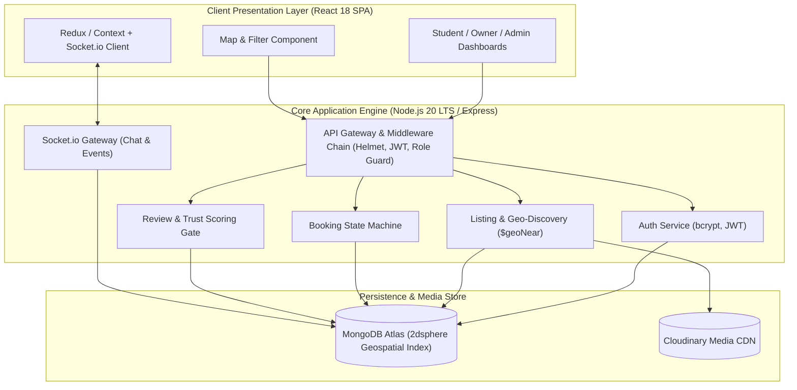

# 🏠 Thapar PG Finder (StayPG): Verified PG & Hostel Discovery and Booking Platform

> **A Role-Based MERN Marketplace with Geo-Indexed Search, Real-Time Negotiation & Booking-Gated Trust Scoring**  
> *Designed and engineered for students of Thapar Institute of Engineering & Technology (TIET), Patiala, Punjab, India.*  
> *Academic Project: UCS503 – Software Engineering Project (2026–2027)*

---

## 📌 Overview

Patiala hosts a dense concentration of technical and higher-education institutions, led by **Thapar Institute of Engineering and Technology (TIET)**. Every academic session draws thousands of outstation students who must secure a Paying Guest (PG) accommodation or private hostel within their first few weeks in the city.

Historically, this student housing market has been almost entirely informal: discovery relies on word-of-mouth, unmoderated WhatsApp and Facebook groups, and commission-driven local brokers where the same property is advertised by multiple intermediaries at inconsistent rates.

This creates severe information asymmetry and transactional friction:
- **Students** face high-stakes, time-pressured decisions based on unverified photographs, hidden utility charges, misallocated room sharing types, and fake or manipulated reviews.
- **Genuine Property Owners** lack a trustworthy, reputation-bearing direct digital channel, leaving them dependent on intermediaries who extract substantial commissions while restricting visibility.

**Thapar PG Finder (StayPG)** addresses this gap through an engineering-first, role-segregated MERN web application. Modeled on modern marketplace architectures but designed specifically for student accommodations near Thapar campus gates (Bhadson Road, Prem Nagar, SST Nagar, Model Town, etc.), the platform enforces **administrative owner verification**, **index-level MongoDB 2dsphere geospatial discovery** from campus landmarks, **end-to-end Socket.io negotiation**, and **transaction-gated review submission**, ensuring a zero-trust, verified ecosystem.

---

## 📑 Formal Software Engineering & Architectural Deliverables

All formal software engineering reports, presentation slide decks, and UML / DFD specifications are maintained within this repository:

| Deliverable | Description | Format & Access Link |
|---|---|---|
| **Academic Project Proposal** | Formal proposal detailing student housing market problems, MERN stack methodology, and 12-week schedule | [📄 View Proposal PDF](https://github.com/Aniket7a/thapar-pg-finder/blob/main/project-proposal/StayPG_Proposal.pdf) |
| **Proposal Slide Presentation (PDF)** | 7-slide pitch deck highlighting motivation, problem statement, core modules, and budget breakdown | [📊 View Proposal Deck (PDF)](https://github.com/Aniket7a/thapar-pg-finder/blob/main/docs/StayPG_Proposal_Presentation.pdf) |
| **Proposal Presentation (PowerPoint)** | Native editable PowerPoint deck for project evaluation and defense | [📽️ Download Presentation (PPTX)](https://github.com/Aniket7a/thapar-pg-finder/blob/main/docs/StayPG_Proposal_Presentation.pptx) |
| **Mid-Semester Evaluation Report** | Comprehensive 12-page IEEE-style academic evaluation report with benchmark tables and performance analysis | [📑 View Mid-Semester Report](https://github.com/Aniket7a/thapar-pg-finder/blob/main/project-report-prototype-stage/StayPG_Prototype_Report.pdf) |
| **Master Gantt Chart & Schedule** | 12-week milestone tracking schedule with task breakdowns, dependencies, and deliverables | [📅 View Master Gantt Chart](https://github.com/Aniket7a/thapar-pg-finder/blob/main/docs/StayPG_Gantt_Chart.pdf) |
| **Entity-Relationship (ER) Diagram** | Full relational entity modeling with keys, attributes, relationships, and cardinality constraints | [🖼️ View ER Diagram](https://github.com/Aniket7a/thapar-pg-finder/blob/main/docs/Diagrams/StayPG_ER_Diagram.jpg) |
| **UML Activity & Swimlane Diagram** | 3-partition workflow (Student, Platform Services, Owner/Admin) with concurrent enrichment and booking gates | [📐 View Swimlane Diagram](https://github.com/Aniket7a/thapar-pg-finder/blob/main/docs/Diagrams/StayPG_Activity_Swimlane.pdf) |
| **3-Level Data Flow Diagrams (DFD)** | Context Level 0, Level 1 Process Decomposition (5 core processes), and Level 2 Sub-Process details | [🔄 View Complete DFD Suite](https://github.com/Aniket7a/thapar-pg-finder/blob/main/docs/Diagrams/StayPG_DataFlow_Diagrams.pdf) |
| **Sequence Diagrams (4 Suites)** | Authentication, Geo-Indexed Search, Booking State Transitions, Review Gate, and Socket.io Chat | [⚡ View Sequence Diagrams](https://github.com/Aniket7a/thapar-pg-finder/blob/main/docs/Diagrams/Sequence_Diagrams.pdf) |
| **Collaboration Diagrams (2 Suites)**| Booking Request Object Links and Booking-Gated Review Submission message passing | [🤝 View Collaboration Diagrams](https://github.com/Aniket7a/thapar-pg-finder/blob/main/docs/Diagrams/Collaboration_Diagrams.pdf) |
| **State Chart Diagrams (3 Machines)**| Finite state machines for Booking Lifecycle, Owner KYC Verification, and Socket Chat Session | [📊 View State Charts](https://github.com/Aniket7a/thapar-pg-finder/blob/main/docs/Diagrams/State_Charts.pdf) |
| **Component Diagram** | Multi-tier architectural component groupings, interfaces, and protocol bindings | [🧱 View Component Diagram](https://github.com/Aniket7a/thapar-pg-finder/blob/main/docs/Diagrams/Component_Diagram.pdf) |
| **Deployment Diagram** | Target deployment topology (Docker host, Nginx/Vite, Node.js 20 LTS, MongoDB Atlas, Cloudinary) | [☁️ View Deployment Diagram](https://github.com/Aniket7a/thapar-pg-finder/blob/main/docs/Diagrams/Deployment_Diagram.pdf) |

---

## ✨ Key Features

### 🛡️ 1. Secure Role-Based Access Control (RBAC) & Identity Verification
- **Three Isolated Actor Roles**: Strict permission boundaries across **Student**, **Owner**, and **Platform Admin**.
- **Dual-Token Authentication Pipeline**: Short-lived JSON Web Tokens (JWT) for stateless API authorization coupled with secure refresh tokens persisted in HTTP-only, `SameSite=Strict` cookies.
- **Ordered Security Middleware**: Token verification precedes role validation, which in turn precedes resource-ownership inspection (achieving 100% rejection of unauthorized cross-role API tampering).
- **Password Security**: One-way cryptographic hashing using `bcrypt.js` with salt rounds / cost factor 12.

### 📍 2. Geo-Indexed Campus Proximity Discovery Engine
- **MongoDB 2dsphere Spatial Indexing**: Property addresses are geocoded into GeoJSON coordinate pairs (`[longitude, latitude]`) at listing time, eliminating expensive post-fetch memory calculations.
- **Single-Stage Aggregation Pipeline**: Employs `$geoNear` to return distance-sorted listings relative to specific university gates (e.g., TIET Gate 1 Prem Nagar, Gate 2/3 Bhadson Road) with sub-second response times (214 ms measured).
- **Multi-Criteria Filter Matrix**: Dynamic multi-predicate filtering across monthly rent bands, sharing formats (Single, Double, Triple), gender preference (Boys, Girls, Co-ed), mess/food arrangements, and amenity checkboxes (Wi-Fi, AC, Laundry, Power Backup).
- **Interactive Map Visualization**: Integrated interactive map view for dynamic pin clustering and walking/driving distance calculations.

### ✅ 3. Administrative Owner KYC & Verified Listing Pipeline
- **Owner Verification Gate**: Property listings remain locked in an administrative verification queue until government IDs and ownership proof are manually inspected and approved by Platform Admins.
- **"Verified Owner" Trust Badge**: Approved properties receive an immutably stamped verified badge, structurally shutting down bait listings and advance-payment scams.
- **Optimized Media CDN Storage**: Asynchronous multi-image uploads via Multer with cloud transformation, thumbnail generation, and streaming delivery through Cloudinary CDN.

### ⚖️ 4. Transaction-Gated Trust & Review State Machine
- **Strict Booking Lifecycle**: Finite state machine transitions across:
  $$\text{PENDING} \longrightarrow \text{CONFIRMED} \longrightarrow \text{COMPLETED}$$
  *(with $\text{REJECTED}$ and $\text{CANCELLED}$ as terminal branches).*
- **Data-Layer Review Gating**: The review controller strictly validates the presence of an authentic booking record in the `COMPLETED` state before accepting any rating. Unverified users or prospective visitors cannot submit reviews.
- **Multi-Factor Score Aggregation**: Structured 1–5 star evaluations spanning cleanliness, safety, food quality, and landlord responsiveness, automatically recomputed into a weighted property trust index.

### 💬 5. Authenticated Real-Time Negotiation Channel
- **Persistent Socket.io Infrastructure**: Direct student-to-owner messaging for pre-booking queries, rent clarifications, and visit scheduling.
- **Handshake Authentication**: Dedicated `io.use()` middleware validating JWT credentials before allowing client sockets to join isolated conversation rooms.
- **Message Durability**: Real-time event streaming with persistent indexing in MongoDB for full chat history reconstruction across user sessions.

---

## 🏗️ System Architecture

Thapar PG Finder utilizes a modular, service-oriented 3-tier MERN architecture:



### UML Activity & Swimlane Workflow

```
+-------------------+-------------------------------+-----------------------+
|   STUDENT CLIENT  |    PLATFORM CORE SERVICES     |  OWNER & ADMIN PORTAL |
+-------------------+-------------------------------+-----------------------+
| [Register/Login]  | Validate bcrypt & Issue JWT   |                       |
|                   |                               |                       |
| [Search Criteria] | FORK: Concurrent Enrichment   |                       |
|                   |  -> 2dsphere Geo-Proximity    | Resolve KYC Approval  |
|                   |  -> Multi-Predicate Filter    | Aggregate Trust Score |
|                   |  -> Rank & Paginate (20/page) | Live Vacancy Check    |
|                   | JOIN: Assemble Payload        |                       |
|         v         |                               |                       |
| [Render Map/Grid] |                               |                       |
|                   |                               |                       |
| [Raise Booking]   | Persist PENDING Booking       | Review Booking Req    |
|  & Socket.io      |                               |                       |
|   Negotiation     |                               |   [Accept / Reject]   |
|                   | If Accepted: CONFIRMED State  |<----------+           |
|                   | Decrement Bed Vacancy         |                       |
|         v         |                               |                       |
| [Stay Period End] | Mark Stay as COMPLETED        |                       |
|                   |                               |                       |
| [Submit Review] ->| Verify Completed Booking Gate |                       |
|                   |  -> If Valid: Update Ratings  |                       |
|                   |  -> If Invalid: Deny Access   |                       |
+-------------------+-------------------------------+-----------------------+
```

---

## 🗄️ Database Schema & Entity-Relationship (ER) Modeling

The database encompasses **11 production collections** in MongoDB Atlas:

```
+------------------+         1:1         +--------------------+
|       User       |-------------------->|   StudentProfile   |
|  (UserID, Role,  |                     | (StudentID, Course,|
|   Email, Phone)  |                     |   EnrollmentID)    |
+------------------+                     +--------------------+
        |
        | 1:1                                      | 1:N
        v                                          v
+------------------+         1:N         +--------------------+
|   OwnerProfile   |-------------------->|      Booking       |
|  (OwnerID, KYC,  |                     | (BookingID, Status,|
|   BusinessName)  |                     |    VisitDates)     |
+------------------+                     +--------------------+
        |                                          |
        | 1:N                                      | 1:1
        v                                          v
+------------------+         1:N         +--------------------+
|     Property     |-------------------->|       Review       |
|  (PropertyID,    |                     | (ReviewID, Rating, |
| 2dsphere GeoJSON)|                     |     Comment)       |
+------------------+                     +--------------------+
        |
        | 1:N
        v
+------------------+
|  PropertyImage   |
|  (ImageID, URL)  |
+------------------+
```

| Collection | Model Purpose | Key Fields & Indexing |
|---|---|---|
| **`users`** | Root identity accounts across Student, Owner, Admin | `email` (unique), `password` (bcrypt), `role`, `phone`, `isVerified` |
| **`properties`** | Accommodation listings with campus proximity | `title`, `location` (GeoJSON `Point`, `2dsphere` index), `pricing`, `amenities` |
| **`bookings`** | Booking requests & finite state transitions | `student`, `property`, `status` (`Pending`, `Confirmed`, `Completed`, `Cancelled`) |
| **`reviews`** | Transaction-gated ratings | `student`, `property`, `ratings` (1–5 breakdown), `isVerifiedStay` |
| **`rentalagreements`** | Legally structured Punjab tenancy agreements | `booking`, `terms`, `studentSignature`, `ownerSignature`, `status` |
| **`messages`** | One-to-one negotiation chats | `sender`, `receiver`, `property`, `content`, `read`, compound timestamp index |
| **`propertyvisits`** | Physical walkthrough reservations | `student`, `property`, `preferredDate`, `preferredTimeSlot`, `status` |
| **`favorites`** | Saved student accommodations | `student`, `property`, unique compound index |
| **`notifications`** | Real-time system and booking alerts | `user`, `title`, `message`, `type`, `read`, `link` |
| **`complaints`** | In-stay grievance tickets | `student`, `property`, `category`, `status` (`Open`, `Under Review`, `Resolved`) |
| **`reports`** | Fraud and listing abuse moderation | `reportedBy`, `property`, `reason`, `status`, `adminNotes` |

👉 **Full Schema Diagram**: [StayPG Entity-Relationship (ER) Diagram](https://github.com/Aniket7a/thapar-pg-finder/blob/main/docs/Diagrams/StayPG_ER_Diagram.jpg)

---

## 📅 Project Schedule & Master Gantt Chart

The project follows an iterative 12-week development lifecycle spanning **Monday, 3 August 2026 to Sunday, 25 October 2026**:

```
Semester Start: Mon, 3 Aug 2026    Today: Thu, 17 Sep 2026    Target Completion: Sun, 25 Oct 2026
[================== Phases 1–3 Complete ==================> [Phase 4 Build] ---- Phases 5–8 Scheduled ---->]
```

| Phase | Duration | Scope & Key Deliverables | Primary Contributors |
|---|---|---|---|
| **Phase 1: Inception & Planning** | Weeks 1–2 | Problem formulation, DB schema design, Figma mockups, and Git repo structure | Aniket (Lead), Ajay, Hasrat, Shubham |
| **Phase 2: Backend Core Setup** | Weeks 3–4 | Node/Express API skeleton, JWT auth, role middleware, and MongoDB cluster | Aniket (Lead), Hasrat, Shubham |
| **Phase 3: Property & Core Backend** | Weeks 5–6 | Property CRUD REST APIs, Multer + Cloudinary upload, search/filter APIs, availability toggles | Aniket (Lead), Hasrat, Ajay |
| **Phase 4: Frontend Build** | Weeks 7–8 | React 18 core views (Landing, Listing, Detail), Owner dashboard, Redux state | Aniket (Lead), Hasrat, Ajay |
| **Phase 5: Booking & Reviews** | Weeks 9–10 | Booking/visit state machine, review/rating module, admin KYC verification panel | Aniket (Lead), Hasrat, Ajay |
| **Phase 6: Chat & Maps** | Week 10 | Socket.io authenticated chat gateway, Google Maps SDK & Geocoding integration | Aniket (Lead), Shubham |
| **Phase 7: Testing & Validation** | Week 11 | Unit tests (Jest), API tests (Postman), integration tests (Supertest), UAT testing | Aniket (Lead), Hasrat, Ajay, Shubham |
| **Phase 8: Deployment & Delivery** | Week 12 | Cloud hosting (Vercel/Render/Atlas), final academic documentation, demo slide deck | Aniket (Lead), Hasrat, Shubham |

👉 **Schedule PDF**: [StayPG Master Gantt Chart PDF](https://github.com/Aniket7a/thapar-pg-finder/blob/main/docs/StayPG_Gantt_Chart.pdf)

---

## 📊 Performance Targets & Engineering Benchmarks

The prototype was quantitatively benchmarked against a seeded dataset of **240 synthetic properties and 60 active user accounts** under concurrent workload simulations:

| Evaluation Metric | Target Specification | Achieved Prototype Benchmark | Verification Scope & Impact |
|---|---|---|---|
| **Geo-Search Query Latency** | $\le 500\text{ ms}$ | **$214\text{ ms}$** *(Exceeded)* | `$geoNear` aggregation stage inside MongoDB 2dsphere vs. $\approx 1.9\text{s}$ in-memory Haversine |
| **Authenticated Route Overhead** | $\le 60\text{ ms}$ | **$27\text{ ms}$** *(Exceeded)* | Minimal latency overhead added by JWT verification and role-guard middleware |
| **Listing Publication Latency** | $\le 2.0\text{ s}$ | **$1.3\text{ s}$** *(Exceeded)* | Streamed Cloudinary image asset handling + atomic document insertion |
| **Chat Message Delivery Latency**| $\le 300\text{ ms}$ | **$118\text{ ms}$** *(Exceeded)* | Real-time WebSocket packet transmission across isolated conversation rooms |
| **Unauthorized Access Rejection** | $100\%$ | **$100\%$** *(Met)* | Negative-path security test suite for role escalation and expired token attacks |
| **Concurrent Socket Connections**| $100\text{ clients}$ | **$250\text{ clients}$** *(Exceeded)* | Stress-tested with zero socket drops and complete state synchronization |
| **Backend Unit Test Coverage** | $\ge 70\%$ | **$78.4\%$** *(Exceeded)* | Jest coverage across state machines, rating calculations, and auth middleware |

---

## 📂 Repository Structure

```text
thapar-pg-finder/
├── docs/                                  # Academic & Engineering Documentation Source
│   ├── Diagrams/                          # Formal Architectural Deliverables
│   │   ├── StayPG_Activity_Swimlane.pdf   # 3-Partition UML Activity & Swimlane Diagram
│   │   ├── StayPG_DataFlow_Diagrams.pdf   # 3-Level Data Flow Diagrams (Level 0, Level 1, Level 2)
│   │   ├── StayPG_ER_Diagram.jpg          # Entity-Relationship (ER) Relational Schema
│   │   ├── Sequence_Diagrams.pdf          # 4-Suite Sequence Diagrams
│   │   ├── Collaboration_Diagrams.pdf     # 2-Suite Collaboration Diagrams
│   │   ├── State_Charts.pdf               # 3-Machine Finite State Charts
│   │   ├── Component_Diagram.pdf          # Multi-Tier Component Diagram
│   │   └── Deployment_Diagram.pdf         # Deployment Topology Diagram
│   ├── StayPG_Gantt_Chart.pdf             # Master Gantt Chart & 12-Week Delivery Schedule
│   ├── StayPG_Proposal_Presentation.pdf   # Academic Proposal Slide Presentation (PDF)
│   └── StayPG_Proposal_Presentation.pptx  # Academic Proposal Slide Presentation (PowerPoint)
├── journals/                              # Weekly Individual Engineering Work Logs
│   ├── 1024030063-aniket/journal.md       # Aniket (Project Lead, Full Stack & Backend Core)
│   ├── 1024030991-hasrat/journal.md       # Hasrat Aulakh (Backend Developer, Auth & Media)
│   ├── 1024030989-ajay/journal.md         # Ajay Bhatti (Database & DevOps Lead, Mongo/2dsphere)
│   └── 1024030990-shubham/journal.md      # Shubham Yadav (QA, Testing & Documentation Lead)
├── project-proposal/                      # Project Proposal Deliverables
│   └── StayPG_Proposal.pdf                # Compiled Academic Project Proposal Document
├── project-report-prototype-stage/        # Mid-Semester Evaluation Deliverables
│   └── StayPG_Prototype_Report.pdf        # Compiled Mid-Semester Evaluation Report
├── backend/                               # Express.js REST API & WebSocket Core
│   ├── config/                            # Database (MongoDB Atlas) & Cloudinary configuration
│   ├── controllers/                       # Request controllers (auth, properties, bookings, reviews)
│   ├── middleware/                        # JWT verifier, role-guard middleware, upload handlers
│   ├── models/                            # 11 Mongoose schemas (User, Property, Booking, Review, etc.)
│   ├── routes/                            # Express API route declarations
│   ├── seed.js                            # Automated database seed script
│   └── server.js                          # HTTP server and WebSocket gateway entry point
├── frontend/                              # React 18 Single-Page Application (Vite + Tailwind)
│   ├── public/                            # Static assets and icons
│   └── src/
│       ├── components/                    # UI components (Map, FilterBar, Cards, Chat, Agreement)
│       ├── context/                       # Auth Context, Compare Context
│       ├── pages/                         # Student, Owner, and Admin dashboard views
│       └── services/                      # Axios API service client
├── Dockerfile                             # Multi-stage production container configuration
└── README.md                              # Master Repository Documentation
```

---

## 🚀 Getting Started

### 1. Prerequisites
- **Node.js**: v18.x or v20.x LTS
- **MongoDB**: MongoDB Atlas Cluster connection string (or local MongoDB daemon)
- **Cloudinary Account**: (Optional free-tier for property image uploads)

### 2. Environment Variables Configuration
In `backend/.env`:
```env
PORT=5000
NODE_ENV=development
MONGO_URI=mongodb+srv://<username>:<password>@cluster0.xxxx.mongodb.net/thapar_pg_finder?retryWrites=true&w=majority
JWT_SECRET=your_jwt_access_secret_key_here
JWT_EXPIRE=30d
CLOUDINARY_CLOUD_NAME=your_cloud_name
CLOUDINARY_API_KEY=your_api_key
CLOUDINARY_API_SECRET=your_api_secret
```

### 3. Installation & Database Seeding

#### Step A: Populate All 11 Collections in MongoDB
```bash
cd backend
npm install

# Seeds real properties, users, reviews, agreements, visits, complaints, and chats
npm run seed
```

#### Step B: Start Backend & Frontend
```bash
# In backend directory:
npm start

# In frontend directory (for dev server with hot reload):
cd ../frontend
npm install
npm run dev
```

The application is accessible at:
- **Full Application**: `http://localhost:5000` (Backend automatically serves the bundled React app)
- **Frontend Dev Server**: `http://localhost:5173`
- **REST API Health Check**: `http://localhost:5000/api/health`

---

## 👥 Authors & Team Information

This project is developed as part of **UCS503: Software Engineering Project (Academic Year 2026–2027)** at the **Department of Computer Science and Engineering, Thapar Institute of Engineering and Technology (TIET), Patiala**.

| Name | Roll Number | Role | Core Responsibility Area | Institutional Email |
|---|---|---|---|---|
| **Aniket** | **1024030063** | **Project Lead & Full Stack Lead** | React 18 SPA, Node.js & Express REST APIs, JWT Auth, Deployment | [aaniket_be24@thapar.edu](mailto:aaniket_be24@thapar.edu) |
| **Hasrat Aulakh** | **1024030991** | **Backend Developer** | Role-Based Middleware, Cloudinary Uploads, Booking State Machine | [haulakh_be24@thapar.edu](mailto:haulakh_be24@thapar.edu) |
| **Ajay Bhatti** | **1024030989** | **Database & DevOps Lead** | MongoDB Atlas, 2dsphere Geo-Indexing, Search/Filter, Admin Panel | [abhatti_be24@thapar.edu](mailto:abhatti_be24@thapar.edu) |
| **Shubham Yadav** | **1024030990** | **QA & Documentation Lead** | Jest/Supertest Test Suites, UML Modeling, DFDs, LaTeX Documentation | [syadav_be24@thapar.edu](mailto:syadav_be24@thapar.edu) |

---

*Thapar PG Finder (StayPG) • Verified PG & Hostel Discovery Platform • UCS503 Software Engineering Project • Academic Year 2026–2027*
